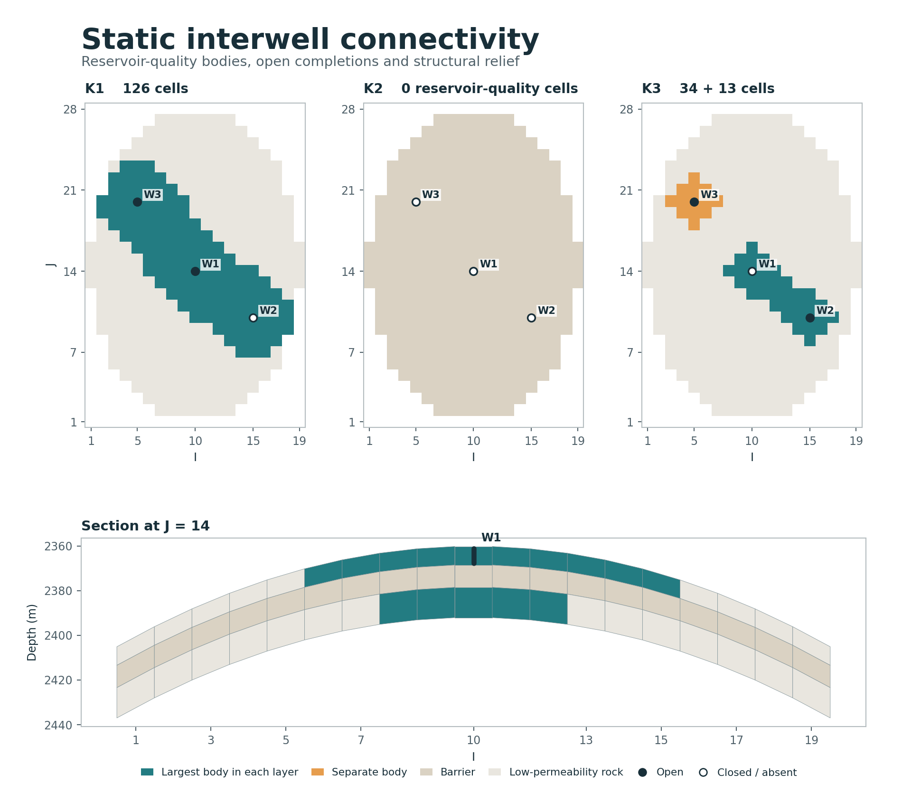

# Experiment 01 · One-shot reservoir interpretation and interwell connectivity

A language model receives one neutral text prompt containing a full numerical reservoir simulation deck. It describes the reservoir and identifies interwell connections in a single JSON reply. The test distinguishes reservoir-quality rock shared by two well columns from a formation path between actually open completions. The primary endpoint is the number of correct well-pair / reservoir-layer labels. Pairwise open-completion paths and traversable formation interfaces are reported separately.

## What the model received

The synthetic case ANTICLINE_3W_2L.DATA is distributed as Case A. Its numerical deck contains the grid geometry, activity, porosity, directional permeabilities and face multipliers, fluid properties, equilibrium contacts, well completions, and operating schedule.

The model received the task and the complete numerical deck in one 119,187-byte UTF-8 message. The trial used gpt-6-astra at maximum reasoning effort. The registration records the evaluation criteria, timestamps and artifact hashes.

- [Exact text sent to the model](prompts/single_step.txt)
- [Numerical deck](inputs/CASE.DATA)
- [Study metadata](protocol/registration.json) · [Registration at the time of the trial](https://github.com/syclong/llm-reservoir-planning-benchmark/blob/a5a54dbf56cb8e2a62160ac5cf5589eac437a59c/experiments/01-reservoir-connectivity/protocol/registration.json)
- [Transport recovery record](protocol/transport_recovery.json)
- [Unedited visible reply](results/model_reply.json)
- [Request and response receipt](results/receipt.json)
- [Scores for individual claims](results/score.json)

## Reservoir and controls

The model grid has 19 × 28 × 3 logical cells. Each layer has 382 active cells, giving 1,146 active cells across the model. Plan-view spacing is 180 m in both directions. The anticline crest has a mean upper-face depth of 2,360.23945 m in the tied cells (10,14) and (10,15). The active upper surface deepens to 2,401.20 m. Depth increases downward.

| Grid layer | Role | Mean thickness (m) | Reservoir-quality cells | Reservoir-quality area (km²) | Size of each connected body (cells) |
|---|---|---:|---:|---:|---|
| K1 | Upper reservoir | 8.31375 | 126 | 4.0824 | 126 |
| K2 | Intervening low-permeability barrier | 10.000 | 0 | 0 | None |
| K3 | Lower reservoir | 13.5575 | 47 | 1.5228 | 34 and 13 |

Reservoir-quality cells have porosities of 0.224–0.237 and horizontal permeabilities of approximately 4,664–5,909 mD. Their vertical permeability is one-tenth of the horizontal permeability. K2 has porosity 0.04, horizontal permeability 0.00001 mD and vertical permeability 0.0000001 mD. All 382 active faces on each internal K interface have zero vertical multiplier. The water–oil contact is at 2,405 m, the gas–oil contact is at 2,355 m, and datum pressure is 234.46 bar at 2,355 m. The model specifies oil, water, gas and dissolved gas. The specified gas–oil contact lies above the active grid. No external aquifer is specified.

All three wells are producers with an oil-rate target of 50 sm³/d and a BHP lower limit of 180 bar. W1 at (10,14) opens K1, W2 at (15,10) opens K3, and W3 at (5,20) opens both K1 and K3. The controls span 365 days from 1 January 1967. Rate targets are schedule inputs.

Filled well symbols mark an open interval. Hollow symbols mark the well-column projection at a layer with no open completion. A column projection alone does not specify the drilled total depth.

## Evaluation

A reservoir-quality cell is active and has both horizontal permeabilities at least 1 mD. For each in-layer pair score, the evaluator checks membership in the same face-connected component. A face must have positive permeability on both sides and a positive directional multiplier on the lower-index cell. For the open-completion score, the evaluator instead starts from the actual OPEN intervals and searches all active rock in three dimensions using the same face criterion. Wellbores do not add graph edges. Only grid layers containing reservoir-quality cells enter the primary endpoint. The three K2 answers where there is no reservoir-quality rock have a separate denominator.

| Pair | Same body in K1 | Same body in K3 | Formation path between OPEN completions | Geological reason |
|---|---|---|---|---|
| W1–W2 | Yes | Yes | No | The wells are open in different layers. Both internal layer faces are sealed. |
| W1–W3 | Yes | No | Yes | Both wells open K1. W3 intersects a separate lower body. |
| W2–W3 | Yes | No | No | W2 is open only in K3, where the two wells occupy different bodies. |

W3 can receive production from both intervals into the same well. All three wells specify disabled well crossflow. W3 therefore supplies no formation edge between the reservoirs in this analysis. Pressure interference magnitude, response time and the allocation of the W3 production rate require dynamic information.

The benchmark's primary graph implementation and an independent sparse-matrix connected-component implementation returned the same pair and interface results. In this case the rock classification is identical at cutoffs of 0.01, 1, 100 and 1,000 mD because matrix and sand permeabilities occupy widely separated ranges. The geometry and layer statistics are also cross-checked independently. [Numerical reference](evaluation/reference.json)

## Recorded result

The first complete visible reply was valid JSON. The model correctly identified all six reservoir-layer well-pair labels, all three formation paths between actual open completions, and both sealed internal interfaces. It recovered the tied crest, the active-cell counts, the layered sand counts and the 34-cell and 13-cell lower bodies. For W2–W3 it specifically identified why the positive-permeability background does not provide a bypass through the zero-multiplier sand boundaries. It also distinguished W3 commingling from vertical communication in the formation.

| Scored group | Correct / total |
|---|---:|
| Reservoir-layer pair labels (primary) | 6 / 6 |
| Open-completion pair paths | 3 / 3 |
| Internal layer interfaces | 2 / 2 |
| Grid and structure | 7 / 7 |
| Layer quantities and roles | 12 / 12 |
| Fluid model and initial contacts | 7 / 7 |
| Well locations and OPEN intervals | 6 / 6 |
| Controls and schedule (literal mode labels) | 7 / 10 |
| Pairs in the layer without reservoir-quality cells | 3 / 3 |

The original registered driver reported 6/7 for grid and structure even though the reply and the frozen JSON reference both give the crest as [10,14]. The driver had passed a Python tuple directly to an exact JSON-array comparison. Scoring the frozen JSON representation corrected that single item. The bundle includes both scores and the publication version of the driver. The connectivity scores are identical under both implementations. [Initial machine score](results/score_registered.json) · [Correction record](protocol/scoring_correction.json) · [Original registered driver](https://github.com/syclong/llm-reservoir-planning-benchmark/blob/a5a54dbf56cb8e2a62160ac5cf5589eac437a59c/experiments/01-reservoir-connectivity/protocol/reproduce_registered.py)

The control-mode field in the prompt permitted text. All three replies explicitly state ORAT in longer sentences, together with the correct rate target and BHP limit. The registered literal evaluator expects exactly the four-character label. The table keeps those three literal mismatches. Reading the replies establishes that the model correctly identified oil-rate control in each well. [Visible reply](results/model_reply.json) · [Item-by-item scores](results/score.json)

The first request timed out. A second transmission of the same prompt returned the scored reply in 313.6 s. The service reported 101,251 input tokens and 18,240 output tokens, including 15,382 reasoning tokens. [Recovery record](protocol/transport_recovery.json) · [Successful receipt](results/receipt.json)

## Reproduction

From this experiment directory, regenerate or verify the bundle with Python 3.10 or later. The main workflow uses the standard library.

~~~sh
python reproduce.py prepare
python reproduce.py verify
~~~

To verify preparation against the original file, add its path to the first command.

~~~sh
python reproduce.py prepare --source /path/to/ANTICLINE_3W_2L.DATA
~~~

To score a different visible JSON reply, run the scoring command against that file.

~~~sh
python reproduce.py score --reply my_reply.json --out my_score.json
~~~

To conduct an independent trial, configure the model executable for a fresh text-only session. It reads one UTF-8 prompt from standard input and writes its reply to standard output. The driver saves the reply, receipt and scores in the named trial directory.

~~~sh
python run_once.py my_trial -- my-text-only-model-command
~~~

The following optional checks use NumPy, SciPy and Matplotlib.

~~~sh
python audit_reference.py
python plot_case.py
~~~

All numerical comparisons, scoring and plotting run outside the tested model. Tests within this one synthetic reservoir share the same inputs and well topology. The denominators describe individual assertions within this one reservoir.
