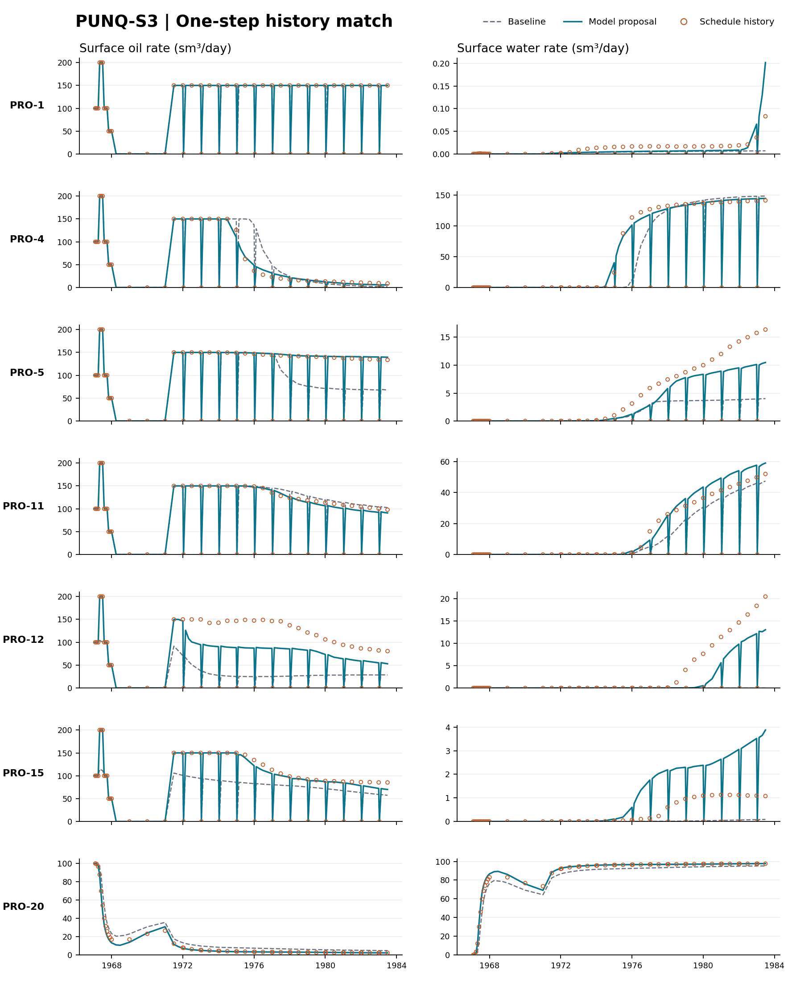
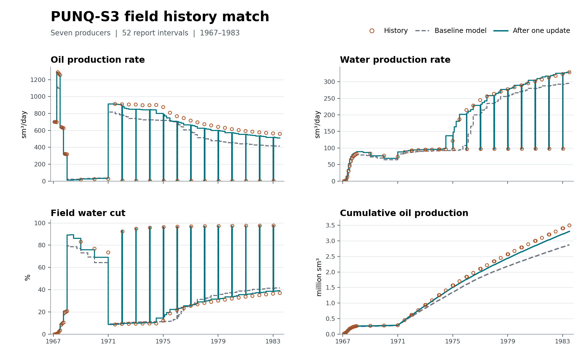

# Experiment 02 · Single-step reservoir history matching

Can a language model improve an existing history match by editing a reservoir's rock properties in one proposal? This experiment uses a seven-producer PUNQ-S3 tutorial case. The model received one English text message and returned one JSON edit set. Python applied the edits to the base DATA deck, and OPM Flow 2026.04 evaluated the candidate from the same initial state.

[Exact model prompt](prompts/single_step.txt) · [Original JSON reply](results/edits.json) · [Starting DATA](inputs/BASE.DATA) · [Updated DATA](results/CANDIDATE.DATA) · [Offline replay program](reproduce.py)

## Recorded results

| Scope and RMSE | Before | After | Relative reduction |
|---|---:|---:|---:|
| Well-balanced water cut (percentage points), primary | 7.2333 | 2.0346 | **71.87%** |
| Oil rate over all well/interval pairs (sm³/day) | 33.30 | 12.10 | 63.67% |
| Water rate over all well/interval pairs (sm³/day) | 8.78 | 2.48 | 71.71% |
| Field water cut (percentage points) | 3.8737 | 1.2574 | **67.54%** |
| Field oil rate (sm³/day) | 109.47 | 33.65 | 69.26% |
| Field water rate (sm³/day) | 26.81 | 5.15 | 80.80% |

Water-cut RMSE decreased at five wells and increased at two. The largest improvement was at PRO-4, from 16.5182 to 3.0210 percentage points. PRO-1 and PRO-15 had higher water-cut errors after the update. At the last report date the field cumulative oil target was 3,493,793.50 sm³. The estimate rose from 2,872,777.75 to 3,302,565.50 sm³, reducing underestimation from 17.77% to 5.47%. These are in-sample results for one proposal on one realization. Independent forecast data would be needed to evaluate predictive performance. [Well scores](results/per_well_comparison.csv) · [Field scores](results/field_history_metrics.json) · [Numerical comparison](results/comparison.json)

| Seven individual wells | Whole field |
|---|---|
|  |  |

[Paired well histories](results/paired_oil_water_rates.csv) · [Paired field histories](results/field_history_comparison.csv) · [Well figure PDF](results/figures/well_history_match.pdf) · [Field figure PDF](results/figures/field_history_match.pdf)

## Model input and proposed changes

The recorded model was `gpt-6-astra`. Its 690,591-byte UTF-8 input contained the complete working deck, the seven oil/water target histories, and all 318 native baseline summary series at all 86 saved times. The input consisted of one user message with zero tools and zero attachments. The [run record](evidence/run.json) ties the message and the returned text to their SHA-256 hashes. The numerical simulation and file handling are performed by the experiment harness.

A proposal assigns absolute porosity fractions and/or permeability values in mD to inclusive, one-based I, J, K ranges. The three permeability components are specified separately. The harness checks bounds, activity, overlapping assignments, numeric validity, and effective changes. It also verifies the simulator-read properties against the native INIT file. The 16 accepted boxes changed porosity in 44 active cells and permeability in 11. One cell changed both, giving 54 distinct modified cells. Geometry, activity, wells, controls, aquifer inputs, and the remaining deck sections were held fixed. [Cell-by-cell changes](results/changed_cells.csv) · [Independent audit](results/independent_audit.json)

## History and scoring

The local input was the seven-well `PUNQ_S3N.DATA` variant of Rock Flow Dynamics' version 25.1 *How to Use Assisted History Matching* tutorial. All needed includes were expanded. The reporting-region map, its declarations and dependent summary requests were removed. No region labels were provided to the model. The deck preserves the two Carter–Tracy aquifers, three-phase fluid properties, initial equilibrium, and the well schedule. It makes two dimension defaults explicit and adds aquifer and restart diagnostics.

The 19 × 28 × 5 grid has 1,761 active cells. The 6,025-day simulation spans January 1, 1967 through July 1, 1983. Each numerical run produced 53 restart snapshots. The baseline and candidate saved 86 and 83 adaptive summary times, respectively. Flow reports warnings for some original diagnostic requests. The required well, field, aquifer, and restart variables are present in the archived solver outputs.

Oil/water history comes from WCONHIST and well status in the DATA schedule. It was verified against WOPRH and WWPRH at each interval end. WOPR and WWPR are the computed responses. The historical targets are tutorial inputs. The separate history text file was unused. There are seven wells and 52 common report intervals, giving 364 paired observations.

The primary score averages squared water-cut residuals over the observed flowing intervals of each well, then averages the seven well means, takes the square root, and multiplies by 100. There are 274 flowing well/interval pairs. A zero simulated liquid rate when the target is flowing contributes one squared error. Oil- and water-rate RMSE use all 364 pairs. The field comparison uses the same 52 report endpoints. Field water cut is the total water rate divided by the total liquid rate across all seven wells. The verifier checks the native field vectors against the sum of the well rates.

## Replay the recorded experiment offline

Run these commands from this directory with Python 3.10 or newer. Verification requires only the Python standard library and the [bundled native evidence](evidence/opm-2026.04-outputs.zip).

~~~sh
python reproduce.py verify
python -m unittest discover -s tests -v
~~~

The verifier checks the hashes of the harness, input deck, complete prompt, raw model reply, and both sets of native outputs. It rebuilds the updated DATA, regenerates the prompt from the baseline, and recomputes the well and field scores. To keep the regenerated histories, pressure/saturation snapshots, and figures, use an empty work directory. Plotting was tested with Matplotlib 3.10.8.

~~~sh
python -m pip install matplotlib==3.10.8
python reproduce.py verify --work runs/replay --plots
~~~

The evidence ZIP contains the original SMSPEC, UNSMRY, ESMRY, EGRID, INIT, UNRST, PRT, and DBG files for each run, together with the corresponding completion receipts. The checked-in prompt and accepted JSON are the exact texts from this experiment.

## Run a fresh experiment

A new numerical run requires the pinned OPM Flow Docker image or a native OPM Flow executable supplied with `--flow`. Automatic model proposals use the local `llm` command on PATH; it must support the named model as a text-only invocation. The model label is defined in the standalone [Python harness](punq_history_match.py). From this directory:

~~~sh
python reproduce.py init --work runs/new
python punq_history_match.py prepare --work runs/new
python punq_history_match.py run --work runs/new
~~~

For a manual proposal, give the model only the contents of `runs/new/prompt.txt`, save its single original JSON reply, and use `submit` in place of `run`. To reevaluate the published edit with the simulator, submit the archived reply. Each independent study uses a fresh directory.

~~~sh
python punq_history_match.py submit --work runs/new --response results/edits.json
~~~

To start from the original tutorial files instead, use `python punq_history_match.py prepare --source PATH_TO_TUTORIAL --work runs/from-source`. The [case manifest](inputs/case.json) records the exact source hashes. For background on the PUNQ benchmark family, see [Floris et al., 2001](https://doi.org/10.1144/petgeo.7.S.S87). This experiment's numerical artifacts describe the specified tutorial variant. The [repository license](LICENSE) covers the original code and documentation. The tutorial data and the simulator retain their respective source terms. [OPM Flow](https://github.com/OPM/opm-simulators)
