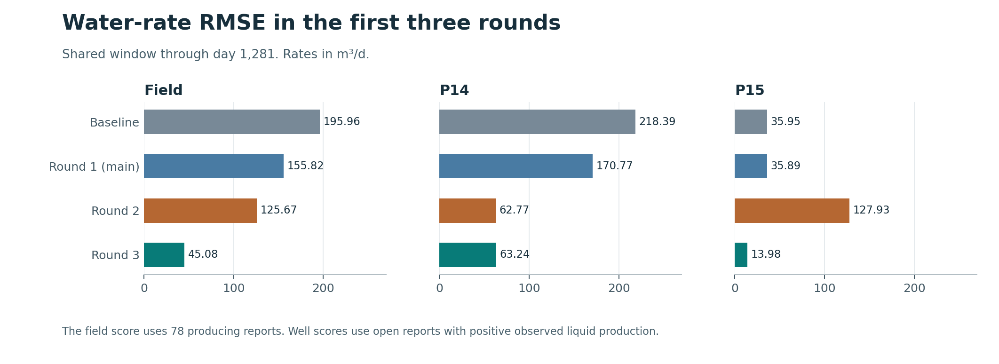

# Experiment 04 · Five rounds of oil and water history matching

Six producers in the UNISIM-IV-2026 compositional reservoir operate under historical total liquid-rate control. The experiment tests whether a language model can use production-rate errors, water saturation and reservoir connectivity to choose where to change rock properties, which properties to change and by how much. The editor was **gpt-6.1-sol** at **xhigh** reasoning effort. JutulDarcy 0.4.1 simulated each candidate from the beginning of the history.

## Five editing rounds

| Case | Decision or comparison | Simulation window | Field oil / water RMSE (m³/d) | Combined NRMSE |
|---|---|---|---:|---:|
| Baseline | Initial field and well responses | 2,891 days / 516 steps | 2,089.43 / 2,089.43 | 37.9776% |
| [Round one](runs/round-01/README.md) | Edit near-well and bottom-water regions using early pressure, gas/oil ratio and water arrivals. The main candidate also tests an initial composition change. | Main case stopped at day 1,912. Permeability-only control stopped at day 1,809. A queued permeability-and-porosity control was withdrawn. | — | — |
| [Round two](runs/round-02/README.md) | Target field and well oil and water rates; strengthen supply along lower connections. | Stopped at day 1,446 | — | — |
| [Round three](runs/round-03/README.md) | Delay early water at P15 and P16. | 2,891 days / 516 steps | 941.81 / 941.81 | 20.7914% |
| [Round four](runs/round-04/README.md) | Test bottom-water and injection contributions to P16 separately. | 2,891 days / 516 steps | 721.00 / 721.00 | 13.9150% |
| [Round five](runs/round-05/README.md) | Reduce pore volume along the existing I12-W to P16 connection. | 2,891 days / 516 steps | 544.72 / 544.72 | **11.6202%** |

Round five ranked first among the completed candidates. Its final state changes porosity and directional permeability relative to the baseline and retains the original five initial component fractions. The full observation history informed the decisions. The fit applies to the supplied geological and well-control model; multiple geological fields can explain the observations.

## Compare rounds one to three

All three main candidates have measurements through day 1,281. Field water-rate RMSE covers the 78 producing report times. Each well's RMSE uses its open intervals with positive observed liquid rate.

| Case | Field water RMSE (m³/d) | P14 water RMSE (m³/d) | P15 water RMSE (m³/d) |
|---|---:|---:|---:|
| Baseline | 195.96 | 218.39 | 35.95 |
| Round one | 155.82 | 170.77 | 35.89 |
| Round two | 125.67 | 62.77 | 127.93 |
| Round three | **45.08** | 63.24 | **13.98** |

Round two improved P14, while water arrived too early at P15. Round three weakened the lower-zone enhancement at P15 and P16. P15 then produced 97.91 m³/d of water on day 1,281 against an observed 86.35 m³/d. The first two rounds have window-specific scores. The third also has a full-period time series.

[Round-three field oil and water curves](results/round3_field_oil_water_history.png) · [Field fit for the selected candidate](results/field_oil_water_history.png) · [Six-well production histories](results/six_well_history_match.png) · [Well RMSE comparison](results/well_rmse_comparison.png)

## Round five and the injection-path storage test

**Feedback.** In round four the saturation front advanced along the I12-W to P16 path, but P16 water production rose later than observed. The model kept the same path and permeability and tested a reduction in local pore volume.

**Field edit.** It used horizontal and vertical Gaussian scales of 180 m and 20 m, truncated at three scales. Eligible active cells had initial water saturation below 0.99 and parent-cell pore volume above 0.001 m³. Each eligible porosity was multiplied by `exp(log(0.5) * path_weight)`. Among 19 DATA/INC inputs, only PORO.inc changed, affecting 1,120 active cells. Cellwise reconstruction agreed with the saved field to a maximum absolute difference of 5.55 × 10⁻¹⁷.

**Response.** At day 1,439, water saturation at the path endpoint (I, J, K) = (13, 14, 211) rose from 0.180691 to 0.190653. P16 water production rose from 12.91 to 27.28 m³/d against 158.39 m³/d observed. Its full-period water-rate RMSE fell from 634.23 to 446.06 m³/d. Water production remained low at the last report. The observed value was 2,192.14 m³/d and the final candidate produced 1,317.91 m³/d.

[Round-five decision](decisions/round5_decision.json) · [Editing script](decision_source/edit_round5.py) · [Input differences](runs/round-05/inputs/round5_path_storage/diff.json) · [Spatial slices](results/round5_spatial_property_changes.png)

## Score and replay

The primary metric weights the field and well components equally. The six wells have equal weight within the well component. Oil and water errors are normalized separately by their historical 95th percentiles at the corresponding level, with a 1 m³/d scale floor. Well samples require an open well and observed liquid above 10⁻⁶ m³/d. Field samples use the same threshold on total observed field liquid. Rates are matched at interval ends. The full ranking spans 2,891 days.

With Python 3.11 or later, NumPy and pandas, run the following command in this directory. It calls the scoring program on the archived wellhead rates and historical controls and checks all four complete score records.

~~~sh
python reproduce.py verify
~~~

To regenerate the six figures, install Matplotlib and run the following command.

~~~sh
python tools/plot_public_figures.py
~~~

| Browse | Files |
|---|---|
| Simulation inputs | [Scored baseline](reference_model/) · [Starting fields for edits](runs/round-00/inputs/baseline_explicit/) · [Selected candidate](model/) |
| Five rounds | [Job index](runs/index.json) · [Decisions](decisions/) · [Editing scripts](decision_source/) · [Round records](protocol/trace_index.json) |
| Evaluation | [Scoring program](tools/score_oil_water.py) · [Candidate ranking](evidence/full_period_candidate_ranking.json) · [Numerical checks](evaluation/local_audit.json) |
| Simulation | [Forward-run entry](tools/rerun_model.ps1) · [Connectivity data](topology/) |
